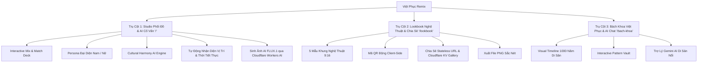

# 🇻🇳 VIỆT PHỤC REMIX (AoDai StyleLab)

> **Cuộc thi:** AI Arena Vietnam 2026  
> **Đề thi Vòng Audition:** Việt phục Remix - Phối trang phục truyền thống theo phong cách Gen Z  
> **Đơn vị tổ chức:** Đại học Quốc gia Hà Nội (VNU) & Google  
> **Đội ngũ phát triển:** The Nerd Duo  
> **Phiên bản:** v2.3 (Kiến trúc Hybrid Multi-Cloud: Google Cloud Run & Cloudflare Pages, Gemini AI & Workers AI FLUX.1)

---

## 🌟 1. Bối Cảnh & Vấn Đề (Problem Statement)

Trang phục truyền thống Việt Nam (Cổ phục) qua các triều đại Lý, Trần, Lê, Nguyễn—từ **Áo Giao Lĩnh, Áo Tứ Thân, Áo Ngũ Thân Tay Chẽn, Áo Tấc** đến **Áo Nhật Bình** và **Áo Dài Lemur/Raglan**—chứa đựng tinh hoa thẩm mỹ và triết lý nhân sinh nghìn năm của dân tộc.

Tuy nhiên, thế hệ trẻ (Gen Z) đang đối mặt với những rào cản lớn:
1. **Khoảng cách tiếp cận & Sợ sai lệch quy chuẩn:** Giới trẻ muốn đưa cổ phục vào đời sống thường nhật (dạo phố, lễ hội, sự kiện nghệ thuật) nhưng e ngại "phạm húy", phối sai nghi thức điển lễ hoặc lệch ngũ hành tương sinh tương khắc.
2. **Thiếu không gian thử nghiệm số hóa trực quan (Mix & Match):** Không có công cụ cho phép trực quan hóa tức thì việc kết hợp giữa phom dáng cổ phục kinh điển và phụ kiện/hơi thở thời đại (Y2K, Cyber Indochine, Streetwear).
3. **Thích ứng thực tế & Thời tiết địa phương:** Cổ phục truyền thống có nhiều lớp và chất liệu đặc thù (gấm, tơ tằm, sa, đũi). Người mặc thường bối rối không biết chất liệu nào phù hợp với điều kiện thời tiết thực tế tại địa phương chụp ảnh.
4. **Nguy cơ sai lệch thẩm mỹ & Hở hang phản cảm khi tạo ảnh AI:** Nhiều mô hình AI tạo sinh trang phục truyền thống dễ bị nhầm lẫn phom dáng, lai tạp văn hóa hoặc tạo ra hình ảnh thiếu kín đáo, không phù hợp thuần phong mỹ tục Việt Nam.

👉 **Việt Phục Remix (AoDai StyleLab)** ra đời như một **Cyber-Heritage Fashion Lab**—kết hợp sức mạnh của **Google Gemini AI**, **Cloudflare Workers AI (FLUX.1)**, **Open-Meteo Real-Time Weather API** và **FLUX Prompt Engine có Guardrails Văn Hóa**, giúp Gen Z tự do sáng tạo bản phối thời trang độc bản mà vẫn tuyệt đối tôn trọng và bảo tồn giá trị di sản.

---

## 🚀 2. 3 Trụ Cột Trải Nghiệm Cốt Lõi



---

### 🎨 Trụ Cột 1: Studio Phối Đồ & Cố Vấn Văn Hóa Thông Minh (`/`)
* **Ma trận phối đồ trực quan & tức thì:**
  * **Cổ phục giám tuyển:** Áo Dài Cách Tân, Áo Ngũ Thân Tay Chẽn, Áo Tấc, Áo Nhật Bình Cung Đình, Áo Tứ Thân Kinh Bắc, Áo Giao Lĩnh Cổ Kính.
  * **Bảng màu di sản & Ngũ Hành:** Đỏ Son (Hỏa), Xanh Ngọc Thanh Thiên (Thủy/Mộc), Vàng Hoàng Cung (Thổ), Đen Huyền Thoại (Thủy), Trắng Ngà Tinh Khôi (Kim).
  * **Bối cảnh sự kiện:** Dạo phố mùa xuân, Lễ tân gia / Cưới hỏi, Triển lãm nghệ thuật đương đại, Lễ hội hoa đăng.
  * **Phong cách Gen Z:** Neo-Y2K, Streetwear Cyber, Minimalist Luxury, Indochine Vintage.
  * **Phụ kiện phối kèm:** Mặc định "Không dùng phụ kiện" để tôn nét mộc mạc nguyên bản; tùy chọn Mấn Tết cách điệu, Vòng kiềng bạc/vàng, Kính râm Y2K, Sneaker chunky, Túi gấm cung đình, Nón quai thao mini.
* **Nhân vật đại diện (Persona):** Vuốt trượt mượt mà giữa Persona Nữ (Dáng chuẩn Á Đông) và Persona Nam (Khí chất đĩnh đạc).
* **Cụm Cố Vấn Văn Hóa Toàn Diện (Cultural Harmony AI - 3 Thẻ Chẩn Đoán):**
  * 📜 **Thẻ 1 - Nguồn gốc & Ý nghĩa:** Phân tích ngắn gọn, chuẩn xác nguồn gốc triều đại và biểu trưng văn hóa của từng kiểu áo cổ truyền.
  * ⛅ **Thẻ 2 - Thời tiết & Chất liệu thích ứng:** 
    * Tích hợp **Open-Meteo API** và cơ chế **Tự động nhận diện vị trí người dùng ngầm** (qua IP Geolocation hoặc GPS) hiển thị nhiệt độ, trạng thái bầu trời thực tế.
    * Gemini AI đưa ra lời khuyên chọn chất liệu vải thông minh (lụa tơ tằm, sa cát, gấm dày, đũi mát...) phù hợp hoàn hảo với thời tiết thực tế tại địa phương.
  * ⚖️ **Thẻ 3 - Quy chế Di sản:** Đánh giá độ chuẩn mực nghi lễ, chấm điểm chuẩn mực 100% hoặc đưa ra cảnh báo guardrail khi phát hiện bản phối phạm quy chế.
  * ⭐ **Đánh giá tổng thể 5 sao & Mẹo Phối Đồ Gen Z:** Gợi ý cách phối tạo điểm nhấn cá tính, hiện đại mà không làm mất đi tính trang nghiêm của trang phục cội nguồn.
* **Tạo Ảnh AI Thực Tế (AI Fashion Visualizer):**
  * Trực tiếp gửi bản phối qua **Cloudflare Workers AI (chạy mô hình FLUX.1)** để sinh ảnh mockup trang phục người mẫu mặc cổ phục Việt Nam sống động, đậm tính điện ảnh.

---

### 🖼️ Trụ Cột 2: Tạo & Chia Sẻ Thẻ Lookbook Nghệ Thuật (`/lookbook`)
* **Khung nghệ thuật chuẩn tỷ lệ 9:16:** 5 mẫu khung giám tuyển (Chu Sa Hoàng Kim, Minimal Luxury, Cyber Indochine, Tem Thư Hà Thành, Giám Tuyển Di Sản) tối ưu chuẩn Story Instagram / TikTok.
* **Mã QR động Client-side:** Tự động tạo mã QR chuẩn tương thích quét tức thì trên camera điện thoại mọi nền tảng.
* **Cơ chế chia sẻ kép:**
  * **Stateless URL (0% Database):** Đóng gói toàn bộ cấu hình phối đồ vào Query Parameters (`/share?g=...&c=...`), chia sẻ tức thì không tốn chi phí lưu trữ máy chủ.
  * **Phòng trưng bày cộng đồng (Cloudflare KV Serverless):** Khám phá và tương tác các bản phối sáng tạo từ cộng đồng yêu Việt phục, lưu trữ phi máy chủ với độ trễ phản hồi mili-giây qua Cloudflare KV.
* **Xuất ảnh chất lượng cao:** Chụp và tải xuống file ảnh PNG độ phân giải sắc nét qua `html-to-image`.

---

### 📜 Trụ Cột 3: Bách Khoa Việt Phục & Trợ Lý Gemini AI (`/bach-khoa`)
* **Gia phả Việt phục (Visual Timeline 1000 Năm):** Tiến trình lịch sử trang phục từ thời Lý, Trần, Hậu Lê, Chúa Nguyễn Phúc Khoát (1744 - Định hình tiền thân áo dài), Vua Minh Mạng (1827), Áo dài Lemur (1930), Raglan (1960) đến làn sóng Phục hưng của Gen Z.
* **Kho tàng hoa văn di sản (Pattern Vault):** Tra cứu ý nghĩa biểu tượng của Mây Ngũ Sắc, Bách Liên Hoa, Long Phụng, Thủy Ba Tam Sơn, Chữ Thọ.
* **Trợ lý Di sản Gemini AI dạng Floating Chatbox:** Nút tương tác nổi ở góc màn hình, hỗ trợ hỏi đáp chuyên sâu điển chế phục sức, phong cách phối đồ thanh lịch đúng văn hóa với khả năng toggle đóng/mở mượt mà.

---

## 🧠 3. Kiến Trúc AI Đột Phá & Responsible AI Guardrails

### 🔄 1. Mô Hình Hybrid AI Pipeline (Zero-Latency + LLM Cố Vấn + Diffusion Tạo Ảnh)

Hệ thống kết hợp 3 tầng trí tuệ nhân tạo phối hợp nhịp nhàng:

```
[Người dùng tương tác bản phối]
           │
           ├─► (0ms Latency) ──► [Local Cultural Engine] ────────► Cập nhật UI & Ngũ Hành tức thì
           │
           ├─► (Debounce 650ms) ─► [In-Memory Cache Check]
           │                               │
           │                       ┌───────┴───────┐
           │                  (Đã cache)      (Chưa cache)
           │                      │               │
           │                      ▼               ▼
           │                 Trả kết quả     Gọi Google Gemini AI (kèm context thời tiết thực)
           │                                      │
           │                              ┌───────┴───────┐
           │                          (Thành công)    (Offline / Quota)
           │                              │               │
           │                              ▼               ▼
           │                      Cố vấn chuyên sâu   Fallback về Rule Engine
           │
           └─► (Người dùng bấm Tạo Ảnh AI)
                                  │
                                  ▼
                     [FLUX Cultural Prompt Engine]
                     (Áp dụng Guardrails thuần phong mỹ tục)
                                  │
                                  ▼
                     [Cloudflare Workers AI (FLUX.1)]
                     (Serverless Edge Inference <10s)
                                  │
                                  ▼
                     Xuất ảnh Việt phục chân thực độ nét cao
```

1. **Local Cultural Engine (`lib/cultural-engine.ts`):** Tính toán tức thì điểm số tương sinh ngũ hành, nguyên lý màu sắc và khuyến cáo cơ bản ngay khi chạm vuốt, triệt tiêu hoàn toàn cảm giác chờ đợi.
2. **Google Gemini Flash Engine (`app/api/cultural-advisor/route.ts` & `functions/api/cultural-advisor.ts`):** 
   * Đóng vai trò **Cố Vấn Di Sản & Thời Trang Việt Phục Cao Cấp**.
   * Tiếp nhận thông số thời tiết thực tế từ Open-Meteo và toạ độ người dùng.
   * Sinh lời khuyên chất liệu vải thích ứng, ý nghĩa cội nguồn và mẹo sáng tạo Gen Z.
3. **Cloudflare Workers AI FLUX.1 Engine (`lib/ai-prompt.ts`):**
   * Đóng vai trò **Họa Sĩ Thời Trang Số**.
   * Thực thi mô hình tạo ảnh FLUX.1 trực tiếp trên mạng lưới Cloudflare Workers AI Serverless, giải quyết triệt để bài toán tạo ảnh trực quan với chi phí $0 và tốc độ cao.
4. **In-Memory Caching & Client Fallback:** Lưu trữ kết quả đánh giá theo tổ hợp món đồ & toạ độ nhằm tối ưu hạn mức API và phản hồi tức thì, bảo đảm ứng dụng luôn sẵn sàng 100%.

---

### ⛅ 2. Tích Hợp Thời Tiết Thực Tế & Tự Động Định Vị (Open-Meteo API)

* **Hoàn toàn miễn phí, 0$ API Key, độ trễ <100ms:** Sử dụng Open-Meteo API phục vụ dữ liệu nhiệt độ, độ ẩm, sức gió và mã WMO thời tiết theo thời gian thực.
* **Tự động nhận diện vị trí người dùng (Auto-Detection):**
  * Tự động nhận diện ngầm qua **IP Geolocation** (`ipwho.is` / `ipapi.co`) chỉ trong 200ms, không hiển thị pop-up xin quyền vị trí gây gián đoạn trải nghiệm.
  * Tự động ưu tiên GPS chính xác cao nếu người dùng đã cấp quyền cho trình duyệt.
  * Tinh giản giao diện: Chỉ hiển thị thanh badge trang nhã `📍 [Thành phố]: [Nhiệt độ]°C • [Tình trạng]` kèm nút refresh nhanh.

---

### 🛡️ 3. Lưới An Toàn Văn Hóa & Thuần Phong Mỹ Tục (FLUX Prompt Engine & Guardrails)

* **FLUX Prompt Engine (`config/flux-prompt-engine.json` & `lib/ai-prompt.ts`):**
  * Cung cấp bộ cấu trúc prompt tạo ảnh AI chuyên sâu cho cổ phục Việt Nam: ánh sáng tự nhiên điện ảnh, chất liệu gấm thêu chân thực, bối cảnh Hoàng thành/Phố cổ/Studio nghệ thuật.
* **Guardrails khống chế tính kín đáo & thuần phong mỹ tục:**
  * Khắc phục triệt để lỗi AI vẽ trang phục hở hang phản cảm (nhất là đối với Áo Tứ Thân Kinh Bắc).
  * Kiểm soát prompt nghiêm ngặt: Áo Tứ Thân luôn đi kèm **yếm lụa kín đáo che ngực, khoác ngoài áo cánh nâu sồng/tứ thân tứ hài, dải lụa thắt eo tao nhã**, thể hiện trọn vẹn nét duyên dáng, e ấp chuẩn mực của người con gái Kinh Bắc truyền thống.
  * Cảnh báo người dùng khi kết hợp trang phục đại lễ (Áo Tấc, Áo Nhật Bình) với phụ kiện quái dị hoặc bối cảnh sinh hoạt thiếu tôn nghiêm.

---

### ⚡ 4. Kiến Trúc Serverless Edge Toàn Cầu (Cloudflare Pages & Cloudflare KV)

* **Cloudflare Pages (Global Edge Hosting):** 
  * Dự án được biên dịch dưới dạng **Static HTML Export** kết hợp **Cloudflare Pages Functions** (`functions/api/*`).
  * Phân phối qua mạng lưới Edge CDN của Cloudflare trên 300+ thành phố toàn cầu với độ trễ cực thấp (<50ms).
* **Cloudflare KV (`LOOKBOOK_KV`):**
  * Lưu trữ phi máy chủ (Serverless Key-Value) cho các bản phối Lookbook được chia sẻ lên Cộng đồng.
  * Không tốn chi phí duy trì cơ sở dữ liệu truyền thống, khả năng mở rộng tức thì không giới hạn.

---

## 🛠️ 4. Tech Stack Tinh Gọn (0$ Cost)

| Thành phần | Công nghệ sử dụng | Phiên bản / Kiểu | Vai trò kiến trúc |
| :--- | :--- | :--- | :--- |
| **Fullstack Framework** | Next.js (App Router, TypeScript) | `14.2.24` | Static Export + Serverless Pages Functions & API Routes |
| **Styling & UI Icons** | Tailwind CSS + Lucide Icons | `3.4.17` / `0.475` | Thiết kế Di sản (Heritage Gold, Son Đỏ, Giấy Dó, Ngọc Bích) |
| **Reasoning GenAI** | Google Gemini 2.0 / 3.5 / 3.8 Flash | `@google/genai` | Cố vấn di sản văn hóa và Trợ lý AI Bách khoa |
| **Diffusion Image GenAI**| Cloudflare Workers AI (FLUX.1 Engine) | Serverless Inference | Sinh ảnh minh họa phối đồ cổ phục chất lượng cao trực tiếp tại Edge |
| **Edge Platform** | Cloudflare Pages + Pages Functions | Serverless Edge | Phân phối ứng dụng toàn cầu với thời gian tải trang <500ms |
| **Edge Storage** | Cloudflare KV (`LOOKBOOK_KV`) | Serverless Key-Value | Lưu trữ thư viện Lookbook cộng đồng chi phí $0 |
| **Weather API** | Open-Meteo API | REST v1 | Cung cấp dữ liệu thời tiết thời gian thực không cần API key |
| **Geo Location** | Silent IP Geolocation + HTML5 GPS | Browser / REST | Tự động nhận diện vị trí người dùng mượt mà |
| **QR Code Engine** | `qrcode` | `^1.5.4` | Sinh mã QR động chuẩn xác phía Client-side |
| **Lookbook Capture** | `html-to-image` | `^1.11.11` | Render và xuất thẻ Lookbook PNG độ nét cao |
| **Prompt Engine** | FLUX Heritage Prompt Engine | v2.0 | Chuẩn hóa prompt tạo ảnh với Guardrails thuần phong mỹ tục |
| **Container & Cloud** | Docker + Google Cloud Run | Multi-stage | Đóng gói container chuẩn hóa, mở rộng tức thì trên Google Cloud |

---

## 📦 5. Hướng Dẫn Cài Đặt & Khởi Chạy

### 1. Yêu cầu môi trường
* Node.js `18.x` hoặc `20.x` trở lên
* Trình quản lý gói `npm` hoặc `yarn`

### 2. Cài đặt Dependencies
```bash
git clone https://github.com/The-Nerd-Duo/AoDai-StyleLab.git
cd AoDai-StyleLab
npm install
```

### 3. Cấu hình Biến Môi Trường (Environment Variables)
Tạo file `.env.local` tại thư mục gốc của dự án:
```env
# Google AI Studio API Key (Gemini)
GEMINI_API_KEY=your_google_ai_studio_api_key_here
NEXT_PUBLIC_GEMINI_API_KEY=your_google_ai_studio_api_key_here

# (Tùy chọn) Endpoint Cloudflare Workers AI sinh ảnh FLUX.1
# Mặc định sử dụng: https://vietphuc-ai-api.tunaemm.workers.dev
```
*(Nếu chưa cấu hình API Key, hệ thống tự động kích hoạt Heritage Rule Engine thông minh dự phòng, bảo đảm ứng dụng luôn vận hành mượt mà 100%).*

### 4. Khởi chạy môi trường Phát triển (Development)
```bash
npm run dev
```
Mở trình duyệt và truy cập: `http://localhost:3000`

### 5. Kiểm tra Build Production Cục Bộ
```bash
npm run build
```
*(Ứng dụng sẽ tự động xuất thư mục tĩnh tối ưu vào `./out` theo cấu hình `output: "export"`).*

---

### 🌐 6. Tùy Chọn 1: Triển Khai Lên Cloudflare Pages & Workers (Khuyên dùng - 0$ Chi Phí)

Dự án đã tích hợp sẵn tệp cấu hình `wrangler.toml` và thư mục `functions/`:

1. **Build tĩnh ứng dụng:**
   ```bash
   npm run build
   ```

2. **Triển khai tức thì qua Cloudflare Wrangler CLI:**
   ```bash
   npx wrangler pages deploy out --project-name aodai-stylelab
   ```

3. **Hoặc kết nối trực tiếp với GitHub Repository trên Cloudflare Dashboard:**
   * **Framework preset:** `Next.js (Static HTML Export)`
   * **Build command:** `npm run build`
   * **Build output directory:** `out`
   * **Environment Variables:** Thêm `GEMINI_API_KEY`
   * **KV Namespace Bindings:** Gán biến `LOOKBOOK_KV` với ID tương ứng trong `wrangler.toml`.

---

### 🐳 7. Tùy Chọn 2: Đóng Gói Docker & Triển Khai Google Cloud Run

Dự án cung cấp sẵn `Dockerfile` đa tầng tối ưu hóa cho môi trường container độc lập:

1. **Build Docker image:**
   ```bash
   docker build -t vietphuc-remix:latest .
   ```

2. **Chạy thử container cục bộ:**
   ```bash
   docker run -p 8080:8080 -e GEMINI_API_KEY=your_key vietphuc-remix:latest
   ```

3. **Triển khai lên Google Cloud Run:**
   ```bash
   gcloud run deploy vietphuc-remix \
     --image gcr.io/YOUR_PROJECT_ID/vietphuc-remix:latest \
     --platform managed \
     --region asia-southeast1 \
     --allow-unauthenticated
   ```

---

## 👥 6. Thông Tin Tác Giả & Bản Quyền

* **Đội thi:** The Nerd Duo
* **Dự án:** AoDai StyleLab / Việt Phục Remix
* **Cuộc thi:** AI Arena Vietnam 2026 (VNU & Google)
* **Giấy phép:** MIT License
* **Liên kết kho lưu trữ:** [https://github.com/The-Nerd-Duo/AoDai-StyleLab](https://github.com/The-Nerd-Duo/AoDai-StyleLab)
