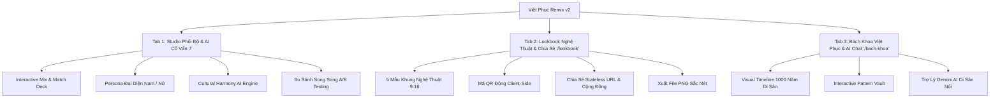

# 🇻🇳 VIỆT PHỤC REMIX (AoDai StyleLab)

> **Cuộc thi:** AI Arena Vietnam 2026  
> **Đề thi Vòng Audition:** Việt phục Remix - Phối trang phục truyền thống theo phong cách Gen Z  
> **Đơn vị tổ chức:** Đại học Quốc gia Hà Nội (VNU) & Google  
> **Đội ngũ phát triển:** The Nerd Duo  

---

## 🌟 1. Bối Cảnh & Vấn Đề (Problem Statement)

Trang phục truyền thống Việt Nam (Cổ phục) qua các triều đại Lý, Trần, Lê, Nguyễn—từ **Áo Giao Lĩnh, Áo Tứ Thân, Áo Ngũ Thân Tay Chẽn, Áo Tấc** đến **Áo Nhật Bình** và **Áo Dài Lemur/Raglan**—chứa đựng tinh hoa thẩm mỹ và triết lý nhân sinh nghìn năm của dân tộc.

Tuy nhiên, thế hệ trẻ (Gen Z) đang đối mặt với những rào cản lớn:
1. **Khoảng cách tiếp cận & Sợ sai lệch quy chuẩn:** Giới trẻ muốn đưa cổ phục vào đời sống thường nhật (dạo phố, lễ hội, sự kiện nghệ thuật) nhưng e ngại "phạm húy", phối sai nghi thức điển lễ hoặc lệch ngũ hành tương sinh tương khắc.
2. **Thiếu không gian thử nghiệm số hóa trực quan (Mix & Match):** Không có công cụ cho phép trực quan hóa tức thì việc kết hợp giữa phom dáng cổ phục kinh điển và phụ kiện/hơi thở thời đại (Y2K, Cyber Indochine, Streetwear).
3. **Thông tin lịch sử rời rạc:** Kiến thức về nguồn gốc, quy chế phục sức và ý nghĩa hoa văn cổ truyền chưa được số hóa thành trải nghiệm tương tác sinh động.

👉 **Việt Phục Remix (AoDai StyleLab)** ra đời như một **Cyber-Heritage Fashion Lab**—kết hợp sức mạnh của **Google Gemini AI** và giao diện tương tác tức thì, giúp Gen Z tự do sáng tạo bản phối thời trang mà vẫn tuyệt đối tôn trọng và bảo tồn giá trị di sản.

---

## 🚀 2. 3 Trụ Cột Tính Năng Cốt Lõi

Ứng dụng được tổ chức khoa học qua 3 trụ cột trải nghiệm:



---

### 🎨 Trụ Cột 1: Studio Phối Đồ & AI Cố Vấn Văn Hóa (`/`)
* **Ma trận phối đồ trực quan:**
  * **Cổ phục giám tuyển:** Áo Dài Cách Tân, Áo Ngũ Thân Tay Chẽn, Áo Tấc, Áo Nhật Bình Cung Đình, Áo Tứ Thân Kinh Bắc, Áo Giao Lĩnh Cổ Kính.
  * **Bảng màu di sản & Ngũ Hành:** Đỏ Son (Hỏa), Xanh Ngọc Thanh Thiên (Thủy/Mộc), Vàng Hoàng Cung (Thổ), Đen Huyền Thoại (Thủy), Trắng Ngà Tinh Khôi (Kim).
  * **Bối cảnh sự kiện:** Dạo phố mùa xuân, Lễ tân gia / Cưới hỏi, Triển lãm nghệ thuật đương đại, Lễ hội hoa đăng.
  * **Phong cách Gen Z:** Neo-Y2K, Streetwear Cyber, Minimalist Luxury, Indochine Vintage.
  * **Phụ kiện phối kèm:** Mặc định "Không dùng phụ kiện" để tôn nét mộc mạc nguyên bản; tùy chọn Mấn Tết cách điệu, Vòng kiềng bạc/vàng, Kính râm Y2K, Sneaker chunky, Túi gấm cung đình, Nón quai thao mini.
* **Nhân vật đại diện (Persona):** Vuốt trượt mượt mà giữa Persona Nữ (Dáng chuẩn Á Đông) và Persona Nam (Khí chất đĩnh đạc).
* **Live Mockup phản hồi tức thì (<0.1s):** Đồng bộ đồ họa trang phục theo thời gian thực.
* **So sánh A/B Testing trực quan:** Lưu biến thể trang phục A và so sánh song song đối chiếu với biến thể B trước khi quyết định.

---

### 🖼️ Trụ Cột 2: Tạo & Chia Sẻ Thẻ Lookbook (`/lookbook`)
* **Khung nghệ thuật chuẩn tỷ lệ 9:16:** 5 mẫu khung giám tuyển (Chu Sa Hoàng Kim, Minimal Luxury, Cyber Indochine, Tem Thư Hà Thành, Giám Tuyển Di Sản) tối ưu chuẩn Story Instagram / TikTok.
* **Mã QR động Client-side:** Tự động tạo mã QR chuẩn tương thích quét tức thì trên camera điện thoại mọi nền tảng.
* **Cơ chế chia sẻ kép:**
  * **Stateless URL (0% Database):** Đóng gói toàn bộ cấu hình phối đồ vào Query Parameters (`/share?g=...&c=...`), chia sẻ tức thì không tốn chi phí lưu trữ máy chủ.
  * **Phòng trưng bày cộng đồng:** Khám phá và tương tác các bản phối sáng tạo từ cộng đồng yêu Việt phục.
* **Xuất ảnh chất lượng cao:** Chụp và tải xuống file ảnh PNG độ phân giải sắc nét qua `html-to-image`.

---

### 📜 Trụ Cột 3: Bách Khoa Việt Phục & Trợ Lý Gemini AI (`/bach-khoa`)
* **Gia phả Việt phục (Visual Timeline 1000 Năm):** Tiến trình lịch sử trang phục từ thời Lý, Trần, Hậu Lê, Chúa Nguyễn Phúc Khoát (1744 - Định hình tiền thân áo dài), Vua Minh Mạng (1827), Áo dài Lemur (1930), Raglan (1960) đến làn sóng Phục hưng của Gen Z.
* **Kho tàng hoa văn di sản (Pattern Vault):** Tra cứu ý nghĩa biểu tượng của Mây Ngũ Sắc, Bách Liên Hoa, Long Phụng, Thủy Ba Tam Sơn, Chữ Thọ.
* **Trợ lý Di sản Gemini AI dạng Floating Chatbox:** Nút tương tác nổi ở góc màn hình, hỗ trợ hỏi đáp chuyên sâu điển chế phục sức, phong cách phối đồ thanh lịch đúng văn hóa với khả năng toggle đóng/mở mượt mà.

---

## 🧠 3. Kiến Trúc AI Đột Phá & Responsible AI

### 🔄 Mô Hình Hybrid AI Architecture (Zero-Latency + Deep Intelligence)

Hệ thống giải quyết bài toán trải nghiệm người dùng bằng mô hình phối hợp **Hybrid**:

```
[Thao tác người dùng vuốt chọn đồ]
                │
                ├─► (0ms Latency) ──► [Local Cultural Engine] ────────► Cập nhật UI ngay lập tức
                │
                └─► (Debounce 650ms) ─► [In-Memory Cache Check]
                                                │
                                    ┌───────────┴───────────┐
                                (Đã có cache)           (Chưa có cache)
                                    │                       │
                                    ▼                       ▼
                              Trả kết quả tức thì      Gọi Gemini 2.0 Flash API
                                                            │
                                            ┌───────────────┴───────────────┐
                                         (Thành công)                 (429 / Offline)
                                            │                               │
                                            ▼                               ▼
                                  Cập nhật đánh giá sâu         Tự động Fallback về Rule Engine
```

1. **Local Cultural Engine (`lib/cultural-engine.ts`):** Tính toán điểm số tương sinh ngũ hành và các khuyến cáo cơ bản ngay lập tức khi người dùng thao tác vuốt trượt, triệt tiêu hoàn toàn cảm giác giật lag.
2. **Google Gemini 2.0 Flash Engine (`app/api/cultural-advisor/route.ts`):** 
   * Đóng vai trò **Cố Vấn Di Sản & Thời Trang Việt Phục**.
   * Thẩm định độ hài hòa màu sắc, tương sinh tương khắc bản mệnh Ngũ Hành.
   * Lời khuyên bối cảnh, thời tiết và mẹo tạo phong cách đột phá cho Gen Z.
3. **In-Memory Caching:** Lưu trữ thông minh kết quả đánh giá theo tổ hợp món đồ nhằm tiết kiệm quota API và tối ưu tốc độ.
4. **Client-Side Direct Fallback:** Đảm bảo hệ thống hoạt động bền bỉ, tự động dự phòng nếu máy chủ gặp hạn chế vị trí địa lý hoặc mất kết nối.

### 🛡️ Lưới An Toàn Văn Hóa (Responsible AI Guardrails)
Hệ thống thiết lập các quy tắc thẩm định văn hóa nghiêm ngặt:
* Cảnh báo khi người dùng kết hợp cổ phục mang tính đại lễ (như Áo Tấc, Áo Nhật Bình) với phụ kiện hoặc bối cảnh sinh hoạt phản cảm, lệch chuẩn nghi thức.
* Hướng dẫn giải pháp thay thế tinh tế: Giữ nguyên tinh thần phóng khoáng Gen Z mà vẫn vẹn nguyên sự tôn nghiêm của trang phục cội nguồn.

---

## 🛠️ 4. Tech Stack Tinh Gọn (0$ Cost)

| Thành phần | Công nghệ sử dụng | Vai trò kiến trúc |
| :--- | :--- | :--- |
| **Framework** | Next.js 14 (App Router, TypeScript) | Nền tảng full-stack hiện đại, SSR/SSG tối ưu SEO |
| **Styling** | Tailwind CSS + Lucide Icons | Hệ thống màu Di sản (Heritage Palette: Son Đỏ, Hoàng Kim, Ngọc Bích, Giấy Dó) |
| **AI Model** | Google Gemini 2.0 Flash (`@google/genai`) | Cố vấn di sản văn hóa và Trợ lý AI Bách khoa |
| **QR Code Engine** | `qrcode` | Sinh mã QR động chuẩn xác trên Client-side |
| **Image Generation** | `html-to-image` | Render và xuất thẻ Lookbook PNG độ nét cao |
| **Container & Cloud** | Docker + Google Cloud Run | Đóng gói container chuẩn hóa, sẵn sàng mở rộng trên hạ tầng Google Cloud |

---

## 📦 5. Hướng Dẫn Cài Đặt & Khởi Chạy

### 1. Yêu cầu môi trường
* Node.js 18.x trở lên
* Trình quản lý gói `npm` hoặc `yarn`

### 2. Cài đặt Dependencies
```bash
git clone https://github.com/The-Nerd-Duo/AoDai-StyleLab.git
cd AoDai-StyleLab
npm install
```

### 3. Cấu hình Biến Môi Trường (Environment Variables)
Tạo file `.env.local` tại thư mục gốc của dự án:
```env
# Google AI Studio API Key (Gemini 2.0 Flash)
GEMINI_API_KEY=your_google_ai_studio_api_key_here
NEXT_PUBLIC_GEMINI_API_KEY=your_google_ai_studio_api_key_here
```
*(Nếu chưa có API Key, hệ thống tự động kích hoạt Heritage Rule Engine thông minh dự phòng, bảo đảm ứng dụng luôn vận hành mượt mà 100%).*

### 4. Khởi chạy môi trường Phát triển (Development)
```bash
npm run dev
```
Mở trình duyệt và truy cập: `http://localhost:3000`

### 5. Build Docker & Triển khai Google Cloud Run
Dự án đã cấu hình sẵn `Dockerfile` đa tầng tối ưu dung lượng:
```bash
# Build Docker image
docker build -t vietphuc-remix:latest .

# Chạy thử container cục bộ
docker run -p 8080:8080 -e GEMINI_API_KEY=your_key vietphuc-remix:latest
```
Triển khai lên Google Cloud Run theo hướng dẫn chuẩn của Google Cloud SDK:
```bash
gcloud run deploy vietphuc-remix \
  --image gcr.io/YOUR_PROJECT_ID/vietphuc-remix:latest \
  --platform managed \
  --region asia-southeast1 \
  --allow-unauthenticated
```

---

## 👥 6. Thông Tin Tác Giả & Bản Quyền

* **Đội thi:** The Nerd Duo
* **Dự án:** AoDai StyleLab / Việt Phục Remix
* **Giấy phép:** MIT License
* **Liên kết kho lưu trữ:** [https://github.com/The-Nerd-Duo/AoDai-StyleLab](https://github.com/The-Nerd-Duo/AoDai-StyleLab)
